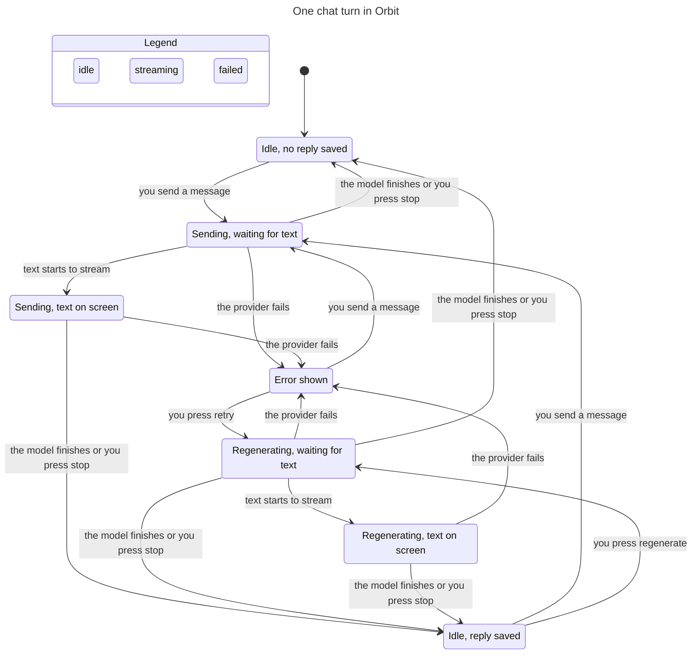

# Architecture

This page explains how Orbit is put together and why. Read it before you change a route, a table, or the chat stream. Setup is in the [README](README.md). Planned work is in the [roadmap](docs/roadmap.md).

## Bird's-eye view

Orbit is one Next.js process. It serves the pages, the API routes, and the chat stream on `127.0.0.1:3210`. It keeps everything in one SQLite file. The browser talks only to that process. Only the server talks to the model provider, so the API key never leaves the server.

<picture>
  <source media="(prefers-color-scheme: dark)" srcset="docs/architecture/stack-dark.png">
  
</picture>

## One chat turn, end to end

1. You type in the composer. assistant-ui sends `POST /api/chat` through `orbitChatTransport` in `src/lib/chat-transport.ts`. The transport puts the open chat id on the request, because assistant-ui would otherwise send its own local thread id.
2. `src/proxy.ts` checks the session cookie and forwards any `Set-Cookie` header better-auth returns when a session refreshes or expires. `src/lib/session.ts` reads the session with refresh disabled so only the proxy moves a session forward. Every page and API route needs a session except `/login`, `/signup`, `/api/auth/*`, and `/api/setup`. An API request with a method other than `GET`, `HEAD`, or `OPTIONS`, other than `/api/auth/*`, gets 403 when it carries a `Sec-Fetch-Site` other than `same-origin`, or, without Fetch Metadata, an `Origin` that is not a trusted origin. The browser sets `Sec-Fetch-Site`, so a write it marks `same-origin` passes without consulting the trusted list. A write with neither header, such as curl, passes. `/api/auth/*` uses better-auth's origin check.
3. `src/app/api/chat/route.ts` reads the body up to `LIMITS.requestBytes` (32 MiB, else `413`), parses it with zod, and holds each message the chat does not store yet to the message limits (a user message over 50,000 characters gets `413`; stored messages keep working at any length), loads the settings row, and calls `planChatWrite` in `src/lib/messages.ts`. That function saves the incoming user messages and returns a `ReplyPlan`: the id the reply will be stored under, plus copies of the prompt row and of the saved reply the stream continues, if any. It refuses a request with no user message with `400`, and a write planned against an older copy of the chat with `409`. It moves `chats.head_id` to the prompt, or to the saved reply the stream continues.
4. The route calls `streamText` from the AI SDK with the model from `orbitModel` in `src/lib/provider.ts` and the tools from `toolsForTurn` in `src/lib/tools/index.ts`. The registry always enables `render_ui`, `remember`, and `forget`, enables `web_search` when a search backend is configured, and enables `run_code` only when the server sets `ORBIT_SANDBOX=on`. `toolsForTurn` also tries to add the `github_*` tools when a GitHub token is saved. If loading fails, the failure is logged as one redacted line and the turn runs without GitHub tools. The route closes the GitHub client when the turn ends. Before the model call, the route asks `recall` in `src/lib/memory/recall.ts` for up to three memories relevant to the last user message. Recall returns none when there are no memories or nothing matches. Otherwise the route attaches them as quoted notes on that user message, as data and not as instructions, and adds `REMEMBER_INSTRUCTIONS` to the system text. The loop stops after at most five model steps. The fifth step allows only `render_ui` and receives the completed conversation as JSON data, so the model answers instead of calling another tool or writing tool-call markup. It keeps the route instructions so the model can answer with citations, render a card, or write an artifact without searching again.
5. The stream goes back to the browser as AI SDK UI message parts. Text, reasoning, and tool parts render as they arrive.
6. When the stream ends, `onEnd` passes the plan and the reply's parts to `finishChatReply` in `src/lib/messages.ts`. It saves only a reply that has a visible part, and nothing when a row the plan copied has changed. A regenerate saves a new sibling and keeps the earlier reply. The hook also starts `embedPending()` in `src/lib/memory/embed.ts`, which fills in the memory vectors Ollama has not returned yet, and closes the GitHub tools.
7. On reload, `src/app/(app)/c/[id]/page.tsx` loads every message and its parent into the history adapter. The chat opens the path ending at `chats.head_id`. The runtime loads them after hydration, so until they reach the thread it shows a placeholder in their shape, or the empty-chat layout when the chat has none.

## The rules of a turn

The chart below is generated from a TLA+ model of steps 3 to 6. TLC, the TLA+ model checker, checks each rule in every reachable state. `scripts/ci/tlc.sh` runs TLC on every model in `docs/architecture/`, locally and in CI. Each rule is something you can see as a user.



These rules hold in every state the model reaches:

- **Nothing is saved without text.** A reply row changes only when you saw text for that turn.
- **Regenerate keeps the old reply.** Every visible new reply is a sibling. A stop or provider failure saves its visible text without changing the earlier reply.
- **A stopped send keeps its text.** If you stop a new message mid-stream, the partial reply is saved and is still there after reload.
- **Text you saw is kept (ShownTextKept).** If you stop and no older reply exists, the text you saw is saved. This covers a retry after a failed first message, which is a regenerate with nothing to replace.

`finishChatReply` saves every reply with visible content. [Slice 4](docs/slices/04.md) gives a regenerate a new id, so saving a partial reply preserves the earlier version. A stop before visible content leaves the head on the saved prompt.

The model tracks up to three reply attempts per prompt with separate ids. A regenerate must keep every earlier reply id. `ChatTurnRegression.tla` checks that a finished reply followed by a finished regenerate leaves two versions.

`ChatTurn.tla` leaves out edits, tool calls, and concurrent tabs. `ChatWrite.tla` models two tabs on one prompt and its reply, with these rules:

- **A saved reply keeps its newest text (ReplyKeepsNewestText).** A tab that loaded the reply before an edit cannot undo the edit when it sends, and a request that continues the reply cannot undo an edit made while it streamed.
- **A saved reply answers its prompt's current text (ReplyAnswersItsPrompt).** A regenerate that streamed while the prompt changed is not saved under the changed prompt.

Both models have mutant configs. Each switches off one guard to replay a past bug, and its `.trace` file holds the counterexample TLC must print, state by state. CI fails if TLC stops finding that counterexample. `ChatWrite.tla` assumes one server process, as Orbit runs, because it treats `planChatWrite` and the route's read of the saved reply it continues as one step. `.agents/skills/verify-chat-turn/SKILL.md` says how to run the models, read a result, update a model when the code changes, and which past bugs the models leave out. `src/lib/model-sync.test.ts` fails when a function a model names changes after the model was last checked.

To rebuild the chart, run the [statechart skill](https://github.com/cursor/plugins/blob/main/pstack/skills/statechart/SKILL.md) on [`docs/architecture/ChatTurn.tla`](docs/architecture/ChatTurn.tla):

```sh
statechart docs/architecture/ChatTurn.tla --config docs/architecture/ChatTurn.cfg --view docs/architecture/chat-turn.view.mjs --out /tmp/chat-turn
```

## Code map

| Path | What lives there |
| --- | --- |
| `src/app/(app)/` | Signed-in pages: the chat at `/c/[id]`, settings, the memory page, and the app shell layout. |
| `src/app/login/`, `src/app/signup/` | The two public pages. |
| `src/app/api/chat/route.ts` | The chat stream. The only route that calls the model. |
| `src/app/api/chats/` | List and create chats, read one chat. `PATCH .../messages/[messageId]` saves an edited reply. |
| `src/app/api/settings/`, `src/app/api/models/` | Read and save the provider, search, and GitHub settings. List the provider's models. |
| `src/app/api/settings/github/check/` | Checks a saved or submitted GitHub token against the MCP server, and returns the login or the error. |
| `src/app/api/memories/` | List and search memories. `PATCH .../[id]` edits one and `DELETE .../[id]` deletes one. |
| `src/app/api/search/` | Full-text search over stored messages. |
| `src/app/api/setup/` | Tells the login page whether signup is still open. |
| `src/instrumentation.ts` | Runs once at server start. It imports the database, which migrates it, starts the dream scheduler, and starts the sandbox sweep when the sandbox is on. |
| `src/proxy.ts` | The session gate for every request. |
| `src/lib/db/` | The SQLite connection, the Drizzle schema, and the migration lock. |
| `src/lib/messages.ts` | Chat and message reads and writes. All write planning lives here. |
| `src/lib/memory/` | Memory storage, hybrid recall, Ollama embeddings, the nightly dream, and the dream scheduler. |
| `src/lib/search.ts` | The FTS5 match queries behind message and memory search. |
| `src/lib/provider.ts` | The model client, reasoning options, the model list, and provider quirks. |
| `src/lib/settings.ts` | The settings row. `toPublicSettings` is the only shape that leaves the server. |
| `src/lib/tools/` | The tool registry, the GitHub MCP client, SearXNG and Tavily search adapters, browser-safe card metadata, and tool status rules. |
| `src/lib/sandbox/` | The fixed container policy, pinned language images, per-run Docker lifecycle, and the sweep of stale containers. |
| `src/components/tools/` | Saved tool run cards, search result links, and the generic JSON disclosure. |
| `src/lib/genui/` | The `render_ui` tool: the component catalog, the spec parser, and the system prompt. |
| `src/components/chat/` | Thread, messages, composer, code blocks, inline editors, and the thread map. |
| `src/components/memory/` | The memory page body: the list, its search, and each row's save and delete errors. |
| `src/components/settings/` | The settings form and its sections. |
| `src/components/auth/` | The shared login and signup form. |
| `src/lib/artifacts/` | Artifact language detection, prompt instructions and the sandboxed frame document. |
| `src/components/artifacts/` | Preview registration, URL selection, lazy compilation and the responsive panel. |
| `src/components/genui/` | The React side of `render_ui`: the component registry and the fallback card. |
| `src/components/shell/` | App shell, sidebar, command palette, and keyboard shortcuts. |
| `src/components/ui/` | shadcn/ui primitives, styled with the tokens in `src/app/globals.css`. |
| `drizzle/` | SQL migrations. `npm run db:generate` writes new ones from `src/lib/db/schema.ts`. |
| `scripts/` | Smoke tests against a running server, the browser QA script with its mock provider, the nightly dream runner (`npm run dream`), and the Cloudflare deploy wizard. |
| `.agents/skills/verify-orbit/` | The verification skill. It launches a sandboxed server and drives each feature. |
| `.agents/skills/verify-chat-turn/` | Model-checks the chat write path with TLC, and records which functions each model describes. |

## Data model

All state is in `data/orbit.db`. The directory is mode `0700`, and the database and `data/auth-secret` are mode `0600`.

| Table | Rows | Notes |
| --- | --- | --- |
| `user`, `session`, `account`, `verification` | better-auth's tables | A SQLite trigger, `user_single_row`, rejects a second user. |
| `settings` | One row, `id = 1` | Base URL, provider key, model, reasoning effort, SearXNG URL, Tavily key, GitHub token, and GitHub MCP URL. The provider key, the Tavily key, and the GitHub token stay on the server. |
| `chats` | One per conversation | `title` starts as `New chat` and takes the first message's text. `head_id` selects the last written branch. |
| `messages` | One per user or assistant message | `parts` is the AI SDK parts array as JSON, and reload reads it. `content` is the plain text of the text parts, then the standard output and standard error of finished code runs, then the source of each code run. Search reads `content`. `parent_id` links each message to its parent. `position` is its depth. Siblings stay in creation order. |
| `memories` | One per saved fact or preference | `kind`, `text` capped at 2,000 characters, normalized text that dedupes, and the source chat and message. `seq` is a stable integer key for the vector table, and `last_used_at` records the last recall that returned it. |
| `memory_runs` | One per night | The dream run: `state`, the lease owner and deadline, the pending, done, and retry chat lists, and the added and merged counts. |
| `messages_fts`, `memories_fts`, `memories_vec` | Search index tables | FTS5 over `messages` and `memories`, kept in sync by triggers, and the `vec0` table of memory embeddings, written by `src/lib/memory/store.ts`. |

Tool output, generated UI specs, and reasoning all live inside `parts`. A new tool needs no new table unless it stores something outside a message.

`run_code` is available only with `ORBIT_SANDBOX=on`. The tool validates language and source, then `runCode` starts a fresh container using only `containerSpec` options. Source arrives on stdin. The runner bounds stdout and stderr and stops work after ten seconds or request cancellation. `runCode` returns two promises: `result`, which settles once with the first of exit, deadline, Stop or Docker error, and `cleanup`, which settles after the container is removed. Once the program has exited, Stop keeps its exit code and a confirmed memory kill, and the deadline only stops waiting for its last output, which then counts as truncated. `runCode` waits at most five seconds for Docker to confirm a memory kill, and a `wait` reply that carries a Docker error fails the run. One cleanup task owns the container, including one Docker finishes creating after Stop returned, and kills it first when the program had not exited. The container runs the interpreter under `timeout`, so it also stops at ten seconds when Orbit dies mid-run. With the sandbox on, `src/instrumentation.ts` starts `startSandboxSweep`, which removes sandbox containers older than a minute at start and every minute after, and logs each removal with its owner. The saved tool part contains the source and final output, with the raw text. The card reads that part after reload and removes terminal escape sequences from the output when it renders. When you press Stop, the AI SDK drops the tool result, so `createStoppedRuns` in `src/lib/tools/stopped-runs.ts` keeps the output the runner had collected, and the chat route saves it as a cancelled result. The open chat then fetches the saved reply and puts that result on the live card (`StoppedRunSync`), so the card matches a reload without replacing the thread. Compose reaches the Docker API through a private socket proxy. See [Security](SECURITY.md#code-sandbox) for that boundary's limits.

Each container carries an owner label beside the shared sandbox label. The owner names the process that made it: one server, one test file or one QA script, from `ORBIT_SANDBOX_OWNER`, or a UUID that `sandboxOwner()` writes to that variable on first use, so every copy of the module in the process and every child process reads one value. Tests, scenarios and leftover checks list containers only through `ownedSandboxFilter` or `ownedSandboxFilterArgs` in `src/lib/sandbox/owner.mjs`, so another Orbit process on the same Docker host cannot fail them. `src/lib/sandbox/sweep.ts` stays allowlisted for host-wide listing so it can remove stale containers left by crashed processes, and `scripts/qa/ci-e2e.sh` fails only on sweep removals for its own owner. `src/lib/sandbox/owner.test.ts` fails when a file names the shared label outside its allowlist, or lists containers without those helpers outside the host-wide allowlist. It reads text, so it cannot see a label built from parts.

## Rules that hold across the code

- **The key stays on the server.** `GET /api/settings` returns `keySet`, `tavilyKeySet`, `githubTokenSet`, and `sandbox` booleans. `sandbox` says only whether the server set `ORBIT_SANDBOX=on`. The browser cannot change it. One `Redactor` (`src/lib/chat-errors.ts`), built from every stored credential, keeps the provider key, the Tavily key, and the GitHub token out of the chat route's log lines, the `errorText` of stream chunks, saved replies and their search text, and GitHub tool results and errors. In saved replies and tool results it replaces each value of 12 or more characters with `[redacted]`, matched literally with overlaps included, after the last step that decodes or joins text; shorter values stay, so a placeholder key such as `ollama` does not rewrite ordinary words. Log lines, stream error text and GitHub tool errors are never masked in place: when the raw error, the uncut text built from it, or the printed line holds a stored value of any length, the whole detail becomes a fixed text (`[redacted]`, or the log label alone), and a fixed text that itself holds a value is skipped. Other stream chunks reach the browser unmasked, and encoded or split keys are not matched (#186). A new settings field must be listed in its `SETTINGS_FIELDS` table, and a field whose name ends in `Key`, `Token`, `Secret`, `Password`, `Pat` or another noun in `CREDENTIAL_NOUNS`, plural, numbered or both, must be labelled `credential`, or typecheck fails. A credential kept in another table or read from the environment when used is outside that table. Tests and smoke scripts redact `ORBIT_API_KEY`.
- **One user.** The auth hook and the database trigger both close signup after the first account.
- **Validate at the edge.** Routes parse request bodies, queries, and path parameters with zod schemas built from `r` in `src/lib/route-schema.ts`, which has no string or list without a size limit. `route-schema.test.ts` fails a route that imports `zod` directly. Tool input is parsed by the tool's schema and then by `parseRenderSpec`. Code behind those checks trusts its types.
- **A browser request names its failure.** Browser code calls `requestJson` in `src/lib/request-json.ts`, never `fetch`. It takes a zod schema, `onOk`, and a required `onFailed` that receives `network`, `http` with the status, `invalid` for a body that is not JSON or does not match the schema, or `handler` when `onOk` threw. `requestJson` never rejects: a handler that throws is logged with `console.error`. A request whose signal was aborted runs neither, and `useLatestRequest` aborts the previous one, so an older answer cannot overwrite a newer one. A load that a screen shows is `Loaded<T>` (`idle`, `pending`, `failed`, `done`), so only `done` can show an empty result. `src/lib/no-direct-fetch.test.ts` fails on a direct `fetch(`, `fetch?.(`, `["fetch"](`, `XMLHttpRequest`, `EventSource`, or `sendBeacon` call; it cannot see an alias of `fetch` or a call split across lines. The chat stream transport is not a JSON request and is out of scope.
- **The server owns history.** The client sends its copy of the thread, but `planChatWrite` decides what is stored and refuses a write against a changed chat.
- **Bind to localhost.** Docker Compose publishes `127.0.0.1:3210` only. The `public` Compose profile starts a `cloudflared` tunnel, so remote access goes through Cloudflare Access and no port opens on the machine.

## Feature boundaries

Shipped and planned slices use these boundaries. The plans in [`docs/slices/`](docs/slices/) give the details.

- **Tools.** `toolsForTurn` in `src/lib/tools/` builds one turn's tools from the registry and adds the `github_*` tools when a GitHub token is saved. [Slice 7](docs/slices/07.md) adds SearXNG search with Tavily as a fallback. Each backend has an eight-second timeout. Tavily cancellation uses a request-scoped signal adapter because the pinned SDK has no signal option. Concurrent requests keep separate signals. The browser shares only card metadata with the registry. Run cards derive running, succeeded, failed, or cancelled from message parts and survive reload. `toolRunEnd` and `toolCallRunEnd` in `src/lib/tools/run-status.ts` are the only code that decides this, and `STOP_MARKERS` there holds every stop text that saved chats store. `run-status-scan.test.ts` fails when another file compares `errorText` or `output.error`, or writes a stop text as a literal. Unknown tools show their output behind a disclosure.
- **Artifacts.** [Slice 5](docs/slices/05.md) renders HTML, SVG, and React code blocks in a side panel. The code runs in an `<iframe sandbox="allow-scripts">` with a strict Content Security Policy, so it cannot read the app's cookies or call its API. The app page paths in `next.config.ts` send `frame-src 'none'`, so the frame cannot load another URL into itself. Route handlers can set their own CSP.
- **History.** Messages form a tree. Edits and regenerates add siblings, and the branch picker switches between them. A reload opens the last written branch. Switching alone does not update `head_id`. A search hit off that branch opens the branch through the hit that was written last, which ends at the newest message below the hit, and does not update `head_id` either.
- **Search.** [Slice 6](docs/slices/06.md) adds an FTS5 index (SQLite full-text search) over `messages`, kept in sync by triggers.
- **GitHub.** [Slice 9](docs/slices/09.md) adds the `github_*` tools from GitHub's MCP server, read-only, limited to the repository, issue, and pull request toolsets. `toolsForTurn` loads them only when the settings row holds a GitHub token, and caches the tool list for five minutes per token. The route closes the client when the turn ends. When the server is unreachable or the token is wrong, the turn still runs without GitHub tools and logs one redacted line. GitHub tool results are untrusted text: the route tells the model so, and run cards render them as links.
- **Memory.** [Slice 10](docs/slices/10.md) adds a `memories` table with its own FTS5 index and a `sqlite-vec` table for embeddings from Ollama. [Slice 11](docs/slices/11.md) fills it from the day's chats each night. A night's row in `memory_runs` changes only through `transition` in `src/lib/memory/run-state.ts`, which `advance` in `src/lib/memory/dream.ts` applies inside one write transaction. A run reaches `done` only with a successful final embed pass, and a failed run keeps every unfinished chat for the next night.

## Rebuild the stack diagram

The diagram source is [`docs/architecture/stack.src.html`](docs/architecture/stack.src.html). Edit it, then build and render it with the [stack-diagram skill](https://github.com/caru-ini/stack-diagram). Its `fetch_icons.py` script downloads the logos.
