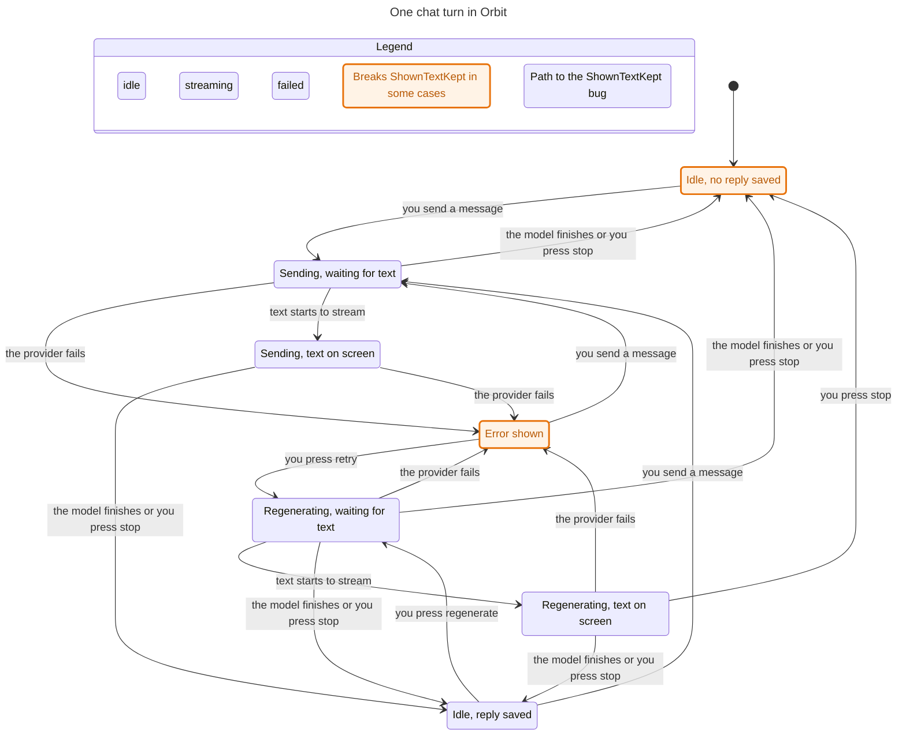

# Architecture

This page explains how Orbit is put together and why. Read it before you change a route, a table, or the chat stream. Setup is in the [README](README.md). Planned work is in the [roadmap](docs/roadmap.md).

## Bird's-eye view

Orbit is one Next.js process. It serves the pages, the API routes, and the chat stream on `127.0.0.1:3210`. It keeps everything in one SQLite file. The browser talks only to that process. Only the server talks to the model provider, so the API key never leaves the server.

<picture>
  <source media="(prefers-color-scheme: dark)" srcset="docs/architecture/stack-dark.png">
  
</picture>

Solid boxes are shipped. The dashed box is planned, and each node names its slice.

## One chat turn, end to end

1. You type in the composer. assistant-ui sends `POST /api/chat` through `orbitChatTransport` in `src/lib/chat-transport.ts`. The transport puts the open chat id on the request, because assistant-ui would otherwise send its own local thread id.
2. `src/proxy.ts` checks the session cookie. Every page and API route needs a session except `/login`, `/signup`, `/api/auth/*`, and `/api/setup`.
3. `src/app/api/chat/route.ts` parses the body with zod, loads the settings row, and calls `planChatWrite` in `src/lib/messages.ts`. That function saves the incoming user messages and picks the id the reply will be stored under. It rejects a write planned against an older copy of the chat with `409`.
4. The route calls `streamText` from the AI SDK with the model from `orbitModel` in `src/lib/provider.ts` and the tools in `src/lib/genui/tool.ts`. Today the only tool is `render_ui`, and the loop stops after one step (`stepCountIs(1)`).
5. The stream goes back to the browser as AI SDK UI message parts. Text, reasoning, and tool parts render as they arrive.
6. When the stream ends, `onEnd` saves the assistant message with `upsertMessage`. It saves only a reply that has a visible part. It never lets a stopped regenerate replace the reply that was already there.
7. On reload, `src/app/(app)/c/[id]/page.tsx` reads the stored `parts` JSON and passes it to the chat as its first messages.

## The rules of a turn

The chart below is generated from a TLA+ model of steps 3 to 6. TLC, the TLA+ model checker, checks each rule in every reachable state. Each rule is something you can see as a user.



These rules hold in every state the model reaches:

- **Nothing is saved without text.** A reply row changes only when you saw text for that turn.
- **Regenerate replaces only with a finished reply.** If you stop a regenerate, or the provider fails, the old reply stays.
- **A stopped send keeps its text.** If you stop a new message mid-stream, the partial reply is saved and is still there after reload.

One rule breaks. **ShownTextKept** says that text you saw survives a stop when there is no older reply. The shortest path that breaks it has five steps:

1. You send a message.
2. The provider fails before any text arrives. The error box shows.
3. You press retry. The retry is a regenerate.
4. Text starts to stream.
5. You press stop. Nothing is saved, so the text is gone after reload.

The cause is in the code, not only the model. `planChatWrite` marks every retry as a regenerate, and the route returns early on `write.regenerate && interrupted` even when no older reply exists. Nobody has reproduced it live yet. [Slice 3](docs/slices/03.md) starts by doing that.

The model leaves out edits, tool calls, and concurrent tabs. The stale-write guard in step 3 covers concurrent tabs, and `src/lib/chat-write.test.ts` tests it.

To rebuild the chart, run the [statechart skill](https://github.com/cursor/plugins/blob/main/pstack/skills/statechart/SKILL.md) on [`docs/architecture/ChatTurn.tla`](docs/architecture/ChatTurn.tla):

```sh
statechart docs/architecture/ChatTurn.tla --config docs/architecture/ChatTurn.cfg --view docs/architecture/chat-turn.view.mjs --out /tmp/chat-turn
```

## Code map

| Path | What lives there |
| --- | --- |
| `src/app/(app)/` | Signed-in pages: the chat at `/c/[id]`, settings, and the app shell layout. |
| `src/app/login/`, `src/app/signup/` | The two public pages. |
| `src/app/api/chat/route.ts` | The chat stream. The only route that calls the model. |
| `src/app/api/chats/` | List and create chats, read one chat. `PATCH .../messages/[messageId]` saves an edited reply. |
| `src/app/api/settings/`, `src/app/api/models/` | Read and save the provider settings. List the provider's models. |
| `src/app/api/setup/` | Tells the login page whether signup is still open. |
| `src/proxy.ts` | The session gate for every request. |
| `src/lib/db/` | The SQLite connection, the Drizzle schema, and the migration lock. |
| `src/lib/messages.ts` | Chat and message reads and writes. All write planning lives here. |
| `src/lib/provider.ts` | The model client, reasoning options, the model list, and provider quirks. |
| `src/lib/settings.ts` | The settings row. `toPublicSettings` is the only shape that leaves the server. |
| `src/lib/genui/` | The `render_ui` tool: the component catalog, the spec parser, and the system prompt. |
| `src/components/chat/` | Thread, messages, composer, code blocks, inline editors, and the thread map. |
| `src/components/genui/` | The React side of `render_ui`: the component registry and the fallback card. |
| `src/components/shell/` | App shell, sidebar, command palette, and keyboard shortcuts. |
| `src/components/ui/` | shadcn/ui primitives, styled with the tokens in `src/app/globals.css`. |
| `drizzle/` | SQL migrations. `npm run db:generate` writes new ones from `src/lib/db/schema.ts`. |
| `scripts/` | Smoke tests against a running server, the provider check, and the browser QA script with its mock provider. |
| `.agents/skills/verify-orbit/` | The verification skill. It launches a sandboxed server and drives each feature. |

## Data model

All state is in `data/orbit.db`. The directory is mode `0700`, and the database and `data/auth-secret` are mode `0600`.

| Table | Rows | Notes |
| --- | --- | --- |
| `user`, `session`, `account`, `verification` | better-auth's tables | A SQLite trigger, `user_single_row`, rejects a second user. |
| `settings` | One row, `id = 1` | Base URL, API key, model, and reasoning effort. The key never leaves the server. |
| `chats` | One per conversation | `title` starts as `New chat` and takes the first message's text. |
| `messages` | One per user or assistant message | `parts` is the AI SDK parts array as JSON, and reload reads it. `content` is the plain text of the text parts. `position` orders the thread. |

Tool output, generated UI specs, and reasoning all live inside `parts`. A new tool needs no new table unless it stores something outside a message.

## Rules that hold across the code

- **The key stays on the server.** `GET /api/settings` returns `keySet: true | false`. Logs pass through `sanitize` in the chat route. Tests and smoke scripts redact `ORBIT_API_KEY`.
- **One user.** The auth hook and the database trigger both close signup after the first account.
- **Validate at the edge.** Routes parse request bodies with zod. Tool input is parsed by the tool's schema and then by `parseRenderSpec`. Code behind those checks trusts its types.
- **The server owns history.** The client sends its copy of the thread, but `planChatWrite` decides what is stored and refuses a write against a changed chat.
- **Bind to localhost.** Docker Compose publishes `127.0.0.1:3210` only. Remote access is planned behind Cloudflare Access in [slice 12](docs/slices/12.md).

## Where planned work plugs in

Each planned slice extends one of these seams. The slice plans in [`docs/slices/`](docs/slices/) give the details.

- **Tools.** `chatTools` in `src/lib/genui/tool.ts` becomes a registry in `src/lib/tools/`. [Slice 7](docs/slices/07.md) raises the step limit so the model can call a tool and then answer. It also adds one run card that every tool shares. The card shows running, succeeded, failed, or cancelled.
- **Artifacts.** [Slice 5](docs/slices/05.md) renders HTML, SVG, and React code blocks in a side panel. The code runs in an `<iframe sandbox="allow-scripts">` with a strict Content Security Policy, so it cannot read the app's cookies or call its API.
- **History.** [Slice 4](docs/slices/04.md) adds `parent_id` to `messages` so edits and regenerates make branches instead of overwriting.
- **Search.** [Slice 6](docs/slices/06.md) adds an FTS5 index (SQLite full-text search) over `messages`, kept in sync by triggers.
- **Memory.** [Slice 10](docs/slices/10.md) adds a `memories` table with its own FTS5 index and a `sqlite-vec` table for embeddings from Ollama. [Slice 11](docs/slices/11.md) fills it from the day's chats each night.

## Rebuild the stack diagram

The diagram source is [`docs/architecture/stack.src.html`](docs/architecture/stack.src.html). Edit it, then build and render it with the [stack-diagram skill](https://github.com/caru-ini/stack-diagram). Its `fetch_icons.py` script downloads the logos.
