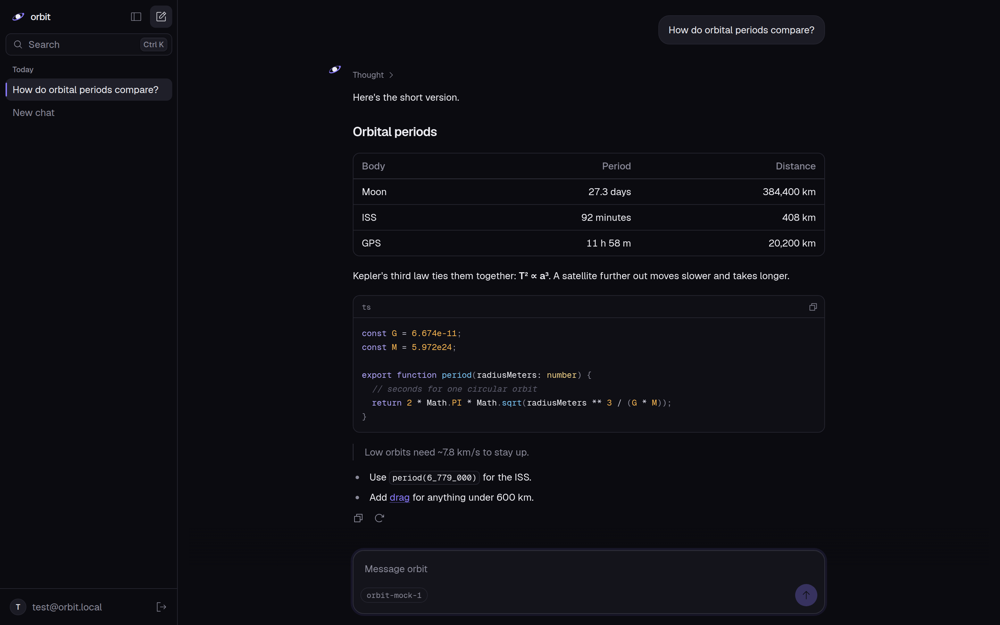

# Orbit

Orbit is a self-hosted chat app, shaped like ChatGPT or Claude, for one person who wants to use any OpenAI-compatible model from their own machine and keep every chat in a local SQLite file.



## What it can do

- Stream replies from any OpenAI-compatible endpoint. You set a base URL, an API key, and a model.
- Show the model's reasoning in a collapsible **Thought** section, with a low, medium, or high effort setting.
- Render cards, tables, metrics, lists, and callouts that the model builds with the `render_ui` tool.
- Edit a sent message and run it again, or edit a reply or a single code block in place.
- Stop a reply mid-stream and keep the text that arrived.
- Find chats with the command palette (⌘K or Ctrl+K) and move around with keyboard shortcuts.
- Keep chats, settings, and the account in `data/orbit.db`. The API key stays on the server.
- Work on a phone at 390 px wide.
- Serve one account. Signup closes after the first one.

Planned features are listed in the [roadmap](docs/roadmap.md).

## Learn more

- [Architecture](ARCHITECTURE.md) explains how a chat turn moves through the code.
- [Contributing](CONTRIBUTING.md) covers development, tests, and pull requests.
- [Security](SECURITY.md) says how to report a vulnerability.
- [Changelog](CHANGELOG.md) lists what changed in each version.
- Orbit is released under the [MIT License](LICENSE).

## Install

### Requirements

| Requirement | Version | Needed for |
| --- | --- | --- |
| An OpenAI-compatible endpoint and API key | Any | Chat |
| Docker with the Compose plugin | Compose v2 (`docker compose`) | Running with Docker |
| Node.js | 22 or later | Running from source |
| npm | 10 or later | Running from source |
| Python 3, `make`, and a C++ compiler | Any | Building `better-sqlite3` from source when no prebuilt binary fits your platform |

### Run with Docker

1. Clone the repository and enter it.

	```sh
	git clone https://github.com/aduthekaddu/orbit.git
	cd orbit
	```

2. Optional: copy `.env.example` to `.env` and fill in `ORBIT_BASE_URL`, `ORBIT_API_KEY`, and `ORBIT_MODEL`. Orbit uses them to fill the settings the first time it starts. You can also enter them later on the **Settings** page.

3. Build and start the container.

	```sh
	docker compose up -d --build
	```

4. Open <http://127.0.0.1:3210> and create your account.

The container stores its data in `./data`. Compose publishes the port on `127.0.0.1` only, so other machines cannot reach it.

### Run from source

1. Clone the repository and install the dependencies.

	```sh
	git clone https://github.com/aduthekaddu/orbit.git
	cd orbit
	npm ci
	```

2. Build and start the server.

	```sh
	npm run build
	npm start -- -p 3210 -H 127.0.0.1
	```

3. Open <http://127.0.0.1:3210> and create your account. Then open **Settings** and enter your base URL, API key, and model.

For development with hot reload, run `npm run dev` instead of steps 2 and 3.

### Configuration

Every variable is optional.

| Variable | Default | What it does |
| --- | --- | --- |
| `ORBIT_BASE_URL`, `ORBIT_API_KEY`, `ORBIT_MODEL` | Empty | Fill the provider settings when the database has none yet. |
| `ORBIT_DATA_DIR` | `./data` | Where Orbit keeps `orbit.db` and `auth-secret`. |
| `BETTER_AUTH_SECRET` | Generated into `data/auth-secret` | The key that signs session cookies. |
| `BETTER_AUTH_URL` | `http://127.0.0.1:3210` | The URL you open Orbit at. |
| `ORBIT_TRUSTED_ORIGINS` | Empty | Extra origins, separated by commas, that may sign in. Needed when you serve Orbit on another port or host. |
